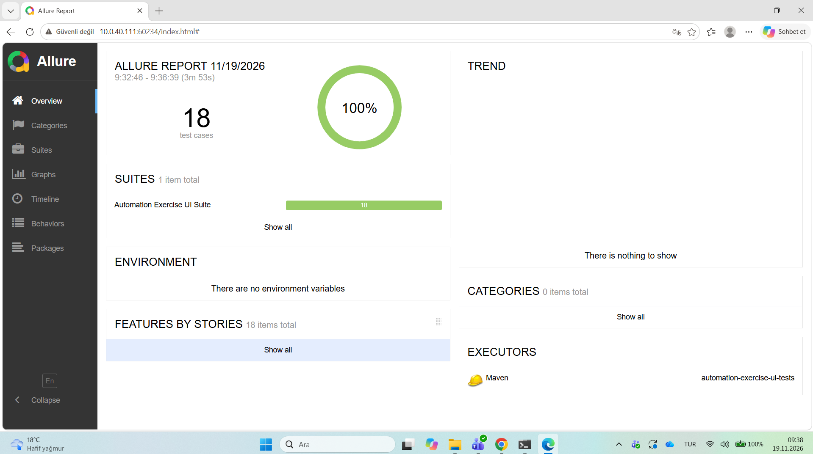

# Automation Exercise UI Test Otomasyonu

[Automation Exercise](https://automationexercise.com/) sitesi icin Selenium + Java ile yazilmis UI test otomasyon projesi (3. hafta odevi).

## Kullanilan teknolojiler

| Arac | Surum | Ne icin? |
|---|---|---|
| Java | 17 | Kodun yazildigi dil |
| Maven | 3.9+ | Derleme, kutuphane indirme, test calistirma |
| Selenium | 4.25.0 | Tarayiciyi yonetme (surucuyu Selenium Manager otomatik indirir) |
| TestNG | 7.10.2 | Test catisi |
| Allure | 2.29.0 | HTML test raporu |

## Kurulum

Gereksinimler: JDK 17 veya uzeri, Maven 3.9+ ve Google Chrome.

```bash
java -version
mvn -version

git clone <repo-url>
cd <repo-klasoru>
mvn clean test-compile
```

## Testleri calistirma

```bash
# Tum testler (testng.xml)
mvn clean test

# Tek bir test sinifi
mvn test -Dtest=LoginTest

# Tek bir test metodu
mvn test -Dtest=LoginTest#loginWithValidCredentialsShouldSucceed

# Karantinadaki testi tek basina calistirma
mvn test -Dtest=CartTest
```

Noktali `-D` parametreleri (ayarlari ezmek icin):

```bash
mvn test "-Dbrowser=edge" "-Dheadless=true" "-Dexplicit.wait.seconds=30"
```

**PowerShell kullaniyorsan** noktali parametreleri tirnak icine al (yukaridaki gibi). Tirnaksiz yazarsan PowerShell parametreyi noktadan boler ve Maven "No plugin found for prefix" hatasi verir. CMD'de tirnak gerekmez.

**Onemli:** `-Dtest=...` ile calistirinca `testng.xml` kullanilmaz; bu yuzden yeniden deneme dinleyicisi ve karantina ayari devreye girmez.

## Rapor: Allure

Testler calisinca sonuclar `target/allure-results` klasorune yazilir. Raporu acmak icin:

```bash
mvn allure:serve
```

Bu komut raporu uretir ve tarayicida acar. Komut sunucu oldugu icin bitmez; kapatmak icin terminalde `Ctrl + C` yap. Ilk calistirmada Allure aracini internetten indirir. `index.html` dosyasina cift tiklayarak acma; yerel dosya olarak acilan rapor yuklenmez.

Raporda gorebileceklerin:

- **Overview:** toplam test sayisi, gecen/kalan orani, sure
- **Behaviors:** Epic, Feature ve Story'lere gore gruplanmis testler
- **Suites:** test adi, Pass/Fail durumu, sure; bir teste tiklayinca adimlari ve hatasi
- Basarisiz testte **ek dosyalar:** hata ani ekran goruntusu, tiklama ve ag kaydi, tarayici konsolu

### Rapor ornekleri

Basarili calistirma:




Basarisiz calistirma. Bu ornek, **kasitli olarak yanlis adres verilerek** uretilmis bir negatif kontroldur (`mvn test -Dtest=HomePageTest "-Dbase.url=https://example.com"`); testin yanlis sayfayi fark edip basarisiz oldugunu ve kanit topladigini gosterir. Urun hatasi degildir.


> Gorsel dosya adlari `docs/raporlar/` klasorundeki gercek adlarla ayni olmalidir; farkliysa yukaridaki yollari duzelt.

### Hata ani kanitlari (rapordan bagimsiz)

Bir test basarisiz olunca otomatik olarak:

- Ekran goruntusu `target/screenshots/` klasorune kaydedilir (dosya adi: test adi + zaman) ve Allure'a eklenir.
- Konsola `[BASARISIZ]` (URL), `[AG]` (tiklama ve ag kaydi) ve `[KONSOL]` (tarayici konsolu) satirlari yazilir.
- Hata mesaji, hangi element beklendigini, o anki URL'i ve sayfa basligini icerir. Sitenin "heavy load" sayfasi donerse mesajda `ORTAM SORUNU` yazar.

`mvn clean` `target/` klasorunu siler; ekran goruntulerine ve Allure sonuclarina bakmak istiyorsan testi tekrar calistirmadan once bak.

## Ayarlar

Tum ayarlar `src/test/resources/config.properties` dosyasindadir ve `-D` ile ezilebilir.

| Anahtar | Varsayilan | Aciklama |
|---|---|---|
| base.url | https://automationexercise.com | Uygulama adresi |
| browser | chrome | chrome, edge veya firefox |
| headless | false | Tarayiciyi pencere acmadan calistirir |
| explicit.wait.seconds | 10 | Kosula bagli bekleme zaman asimi (saniye) |
| page.load.timeout | 30 | Sayfa yukleme zaman asimi (saniye) |

## Testler

14 aktif test metodu (tam suite'te 18 calistirma; veri tabanli testler birden fazla kez calisir).

| Sinif | Test | Case | Tur |
|---|---|---|---|
| HomePageTest | Ana sayfa acilir | Smoke | Pozitif |
| LoginTest | Gecerli giris | AUTH-013 | Pozitif |
| LoginTest | Yanlis sifre | AUTH-014 | Negatif |
| LoginTest | Kayitsiz e-posta | AUTH-015 | Negatif |
| LoginTest | Bos alanlarla giris (3 veri satiri) | AUTH-016/017/018 | Negatif |
| LogoutTest | Oturum kapatma | AUTH-019 | Pozitif |
| RegisterTest | Yeni kullanici kaydi ve hesap silme | AUTH-001 | Pozitif |
| RegisterTest | Kayitli e-posta ile tekrar kayit | AUTH-002 | Negatif |
| ProductsTest | Var olan urun arama (3 veri satiri) | PROD-003/004 | Pozitif |
| ProductsTest | Var olmayan urun arama | PROD-006 | Negatif |
| ProductsTest | Urun listesi | PROD-001 | Pozitif |
| WaitComparisonTest | Statik ve dinamik bekleme olcumu (3 test) | - | Olcum |

Karantinadaki testler (yazildi, kararsiz oldugu icin toplu calistirmadan cikarildi): `CartTest` (CART-001) ve `CheckoutTest` (CHK-002). Ayrinti: [docs/bilinen-sorunlar.md](docs/bilinen-sorunlar.md).

Her test kendi temiz tarayicisiyla baslar. Kayitli kullanici gereken testler kendi kullanicisini olusturur ve sonunda siler (`UserTest`), bu yuzden testler birbirinden bagimsizdir ve tekrar calistirilabilir. Site zaman zaman asiri yuk sayfasi dondurdugu icin, yalnizca `ORTAM SORUNU` isaretli hatalar en fazla 2 kez yeniden denenir; gercek dogrulama hatalari hic yeniden denenmez.

## Klasor yapisi

```
src/test/java/com/automationexercise/
  base/         BaseTest, UserTest (tarayici ac/kapat, temizlik)
  components/   Header (ust menu)
  config/       ConfigReader (ayar okuyucu)
  driver/       DriverFactory (tarayici olusturma, reklam engelleme)
  listeners/    RetryListener, EnvironmentRetryAnalyzer
  models/       User
  pages/        Page Object siniflari (BasePage, HomePage, LoginPage, ...)
  tests/        Test siniflari
  utils/        WaitHelper, TestDataGenerator, NetworkProbe
src/test/resources/
  config.properties, allure.properties, testng.xml
docs/           Analiz ve karsilastirma dokumanlari
```

## Dokumanlar

| Dosya | Icerik |
|---|---|
| docs/locator-analizi.md | Locator'lar, secim gerekceleri, dogrulama durumu |
| docs/bekleme-stratejileri.md | Statik ve dinamik bekleme karsilastirmasi ve olcumler |
| docs/otomasyon-uygunluk.md | 2. haftadaki 53 manuel case'in otomasyon uygunluk analizi |
| docs/bilinen-sorunlar.md | Kararsiz sepet testinin olcumleri ve hipotezleri |